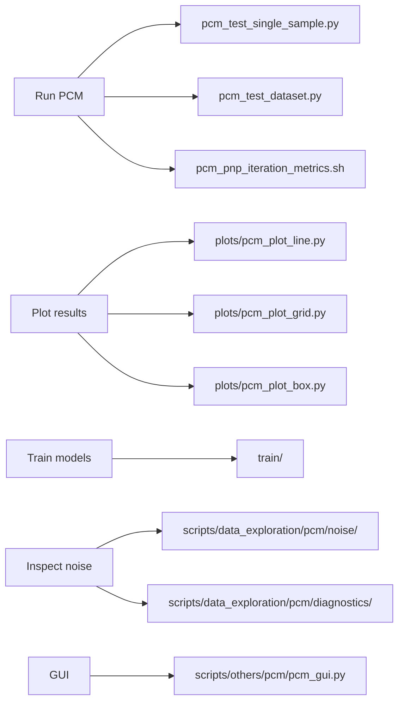

# PCM scripts

Small entry points for running, plotting, training, debugging, and viewing photocurrent mapping experiments.



## What should I run?

| Goal | Entry point |
| --- | --- |
| Run one sample | `pcm_test_single_sample.py` |
| Run a dataset | `pcm_test_dataset.py` |
| Compare PnP iteration metrics, methods, noise realizations, and snapshots | `pcm_pnp_iteration_metrics.sh` |
| Open the PCM GUI | `scripts/others/pcm/pcm_gui.py` |
| Plot a metric against sampling rate | `plots/pcm_plot_line.py` |
| Plot a sampling/coarse-J grid | `plots/pcm_plot_grid.py` |
| Plot method-comparison box plots | `plots/pcm_plot_box.py` |
| Re-render a saved lambda map | `plots/pcm_render_lambda.py` |
| Train/test PCM SAPM models | `train/` |
| Inspect the PCM noise model | `scripts/data_exploration/pcm/noise/`, `scripts/data_exploration/pcm/diagnostics/` |
| Inspect saved results | Output directories selected by the experiment or plotting script |

## Common commands

Run the E27 average-map preset:

```bash
python scripts/experiments/pcm/pcm_test_single_sample.py \
    --preset e27_pos1_average_map_simulated_noise
```

Run the CIA PnP iteration comparison:

```bash
bash scripts/experiments/pcm/pcm_pnp_iteration_metrics.sh
```

The CIA script sets methods, noise realizations, snapshot iterations,
and plot layouts in the shell file. Its current example runs
`pnp_admm_drunet` at 10% sampling and coarse J = 6, with a no-noise case
and one simulated-noise realization. Edit its arguments to compare other
methods and sampling settings.

The no-noise and noisy scenarios use the same Hadamard sampling pattern.
Different noise realizations also keep that sampling pattern fixed and vary
only the simulated noise.

The script can save:

- one figure for each method/scenario pair;
- methods overlaid within each noise scenario;
- noise scenarios overlaid for each method.

Selected snapshot iterations, the best reconstruction according to a chosen metric,
and the last reconstruction can be shown as images in the same figure. The selected
points are marked on PSNR, SSIM, HaarPSI, and MSE curves. Figures can use either
iteration number or cumulative reconstruction time on the x-axis.

## Folder guide

- `train/`: current PCM training and checkpoint-testing scripts.
- `plots/`: reconstruction metrics, saved image visualisation and box plots.
- `slides/`: comparison-figure export and slide transfer scripts.
- `tv/`: scalar-TV sweeps and merging result files.
- `scripts/data_exploration/pcm/noise/`: PCM noise simulation examples and notebooks.
- `scripts/data_exploration/pcm/diagnostics/`: focused acquisition/noise diagnostics.
- `scripts/others/pcm/`: the standalone GUI launcher and miscellaneous utilities.

## Retained experiment launchers

The Python entry points above remain the recommended way to run new experiments.
Several Bash wrappers are also kept because they capture useful run settings:

- `quick_test_debug_original.sh`, `quick_test_debug_dataset.sh`, and
  `pcm_test_single_sample.sh`: specific single-sample and dataset trials.
- `pcm_pnp_iteration_metrics.sh` and `slides/pcm_pnp_slide_data.sh`: iteration
  diagnostics and figure exports.
- `plots/pcm_render_lambda.sh` and `tv/sweep.sh`: saved adaptive-map rendering
  settings and scalar-TV parameter sweeps.
- `train/supervised_tv_pcm.sh`, `train/pcm_ssdu_train.sh`,
  `train/test_supervised_sapm.sh`, and `train/pcm_test_ssdu.sh`:
  saved supervised and self-supervised training/evaluation configurations.
- `train/zs.sh`: a historical zero-shot configuration. It now calls the
  dedicated zero-shot entry point, `train/pcm_zero_shot_sapm_train.py`.
  Review its data/configuration settings before launching training.

Some wrappers specify machine-local directories, old checkpoints or particular
CUDA devices. Review these settings before running them elsewhere.

## Archived legacy scripts

The cleanup moved **22 scripts (16 Bash, 6 Python)** from the active `scripts/`
tree into the local directory `to_delete/removed_scripts_1/`. The original
relative paths are preserved, and `ARCHIVE_MANIFEST.txt` lists every file.

The archived scripts include:

- Older `full_test_*`, `quick_test_debug.sh`, `quick_test_gaussian.sh`,
  `quick_test_pcm_noise_scale.sh`, `test_dwt.sh`, and `test_pcm.sh`
  launchers. Most call the missing `scripts/pcm/photocurrent_mapping.py`
  entry point; another uses an inactive preset.
- `poc.py`, the earlier PySide6 GUI prototype, superseded by `pcm_gui.py`.
- `supervised_gs_drunet_train.py`, which actually targets an external
  Cartesian MRI project rather than PCM denoiser training.
- `train_denoise.py` and `train_gs_drunet.py`, incomplete or outdated
  denoiser-training experiments.
- The two legacy `scripts/example_scripts/photocurrent_mapping*.py`
  examples, replaced by the current PCM workflows.

**The `to_delete/` archive is ignored by Git.** It exists locally but is not
included in ordinary commits or other clones. Git history can restore the
original tracked files if needed.

## Naming rule for new scripts

For new scripts, prefer:

```text
pcm_<task>.py
pcm_<task>.sh
```

If a shell script only launches one Python entry point, keep the same stem
where practical. Prefer editing a maintained preset over adding a one-off
wrapper.

## Cleanup approach

Do not delete uncertain scripts just because they look old.

A safer sequence is:

1. Mark clearly stale files in this README.
2. Confirm whether anything still calls them.
3. Move confirmed historical scripts into a dated or numbered folder under
   `to_delete/`, preserving their relative paths.
4. Review this local archive before permanently deleting anything.

This keeps cleanup gradual and reversible.
